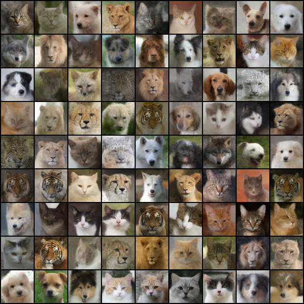

# Denoising Diffusion Probabilistic Models

DDPM (Denoising Diffusion Probabilistic Models) is a method that achieves state-of-the-art results for unconditional image synthesis.

## Installation

```console
git clone https://github.com/bareform/dependencies.git
conda update -n base -c defaults conda
conda env create -f dependencies/environment.yml
conda activate bareform

git clone https://github.com/bareform/ddpm.git
cd ddpm
```

<details>
  <summary> Dependencies (click to expand) </summary>
  
  ## Dependencies
  - Python 3.10
  - datasets
  - numpy
  - torch
  - torchvision
    
</details>

## Quick Start

To train a low-res `AFHQ` DDPM:

```
python3 -m utils.trainer --config="./configs/afhq.toml"
```

After training for 500K steps, you can find results similiar to the image at `./assets/afhq/afhq.png`.



Using the configuration provided at `./configs/afhq.toml`, we achieve a mean FID score of 15.18 with a standard deviation of 0.169 over 10 runs.

You can download the pre-trained models [here](https://huggingface.co/luethan2025/ddpm) and use the provided Jupyter Notebook `inference.ipynb` to generate some samples.

## Method

[Denoising Diffusion Probabilistic Models](https://arxiv.org/abs/2006.11239)

Jonathan Ho, Ajay Jain, Pieter Abbeel

UC Berkeley

> We present high quality image synthesis results using diffusion probabilistic models, a class of latent variable models inspired by considerations from nonequilibrium thermodynamics. Our best results are obtained by training on a weighted variational bound designed according to a novel connection between diffusion probabilistic models and denoising score matching with Langevin dynamics, and our models naturally admit a progressive lossy decompression scheme that can be interpreted as a generalization of autoregressive decoding. On the unconditional CIFAR10 dataset, we obtain an Inception score of 9.46 and a state-of-the-art FID score of 3.17. On 256x256 LSUN, we obtain sample quality similar to ProgressiveGAN.

## Citation

The original paper can be found at:
```
@misc{ho2020ddpm,
    title={Denoising Diffusion Probabilistic Models},
    author={Jonathan Ho and Ajay Jain and Pieter Abbeel},
    year={2020},
    eprint={2006.11239},
    archivePrefix={arXiv},
    primaryClass={cs.LG}
}
```
